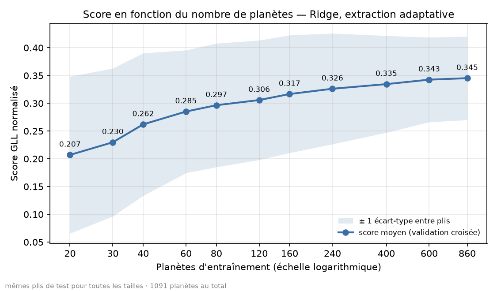

# NeurIPS — Ariel Data Challenge 2025 · pipeline MLOps reproductible

Extraction du spectre de transmission d'exoplanètes (mission ESA Ariel, données simulées) et
prédiction **μ ± σ** de Rp/Rs sur 283 longueurs d'onde, avec une chaîne MLOps complète.
Métrique : Gaussian Log-Likelihood normalisée (0 = baseline naïve, 1 = oracle).

**Version courante : v0.3.0** — extraction à fenêtre adaptative, **retraitement des 1100 planètes**, filtre de qualité
à l'entraînement, pipeline reproductible avec DVC, inférence sur le jeu de test.

## Résultat

| | v0.1.0 | v0.2.0 | v0.3.0 |
|---|---|---|---|
| Planètes utilisées | 140 | 160 | 1091 (1071 en entraînement + 20 en validation ; 9 écartées) |
| Score GLL, validation fixe (mêmes 20 planètes) | 0,19 | 0,380 (IC 90 % : 0,330 – 0,420) | **0,398** (IC 90 % : 0,367 – 0,430) |
| Score GLL, validation croisée (5 plis × 3 répétitions) | 0,158 | 0,337 (écart-type entre plis 0,098) | **0,345** (écart-type 0,073) |
| Médiane des scores par planète (hors échantillon) | — | — | 0,401 |
| Moyenne sans la pire planète | — | — | 0,380 |

Le modèle est resté un Ridge (α = 10) sur Rp² et les paramètres stellaires/orbitaux, avec un σ constant par
longueur d'onde. **Le score moyen progresse peu entre la v0.2.0 et la v0.3.0** (+0,018 en validation fixe, intervalles
qui se recouvrent ; +0,008 en validation croisée, mais évalué sur 1091 planètes au lieu de 160, donc non apparié). Ce
que la v0.3.0 apporte, c'est une mesure bien plus fiable, la courbe d'apprentissage complète (le Ridge sature, voir
plus bas) et un filtre qui protège l'entraînement des échecs d'extraction (+0,08 de score, voir plus bas).

La moyenne est sensible à une seule planète : `3188116178` (niveau d'extraction 0,56, juste au-dessus du seuil du
filtre) obtient −37,8 en validation croisée et fait passer la moyenne de 0,380 à 0,345 à elle seule. La médiane et la
moyenne sans cette planète sont donc données à côté du score moyen.

### Combien de planètes faut-il ?

Courbe d'apprentissage (`scripts/learning_curve.py`, 1091 planètes, validation croisée, 10 répétitions, mêmes plis de
test pour toutes les tailles, bande = ± 1 écart-type entre plis) :



| Planètes d'entraînement | 20 | 40 | 80 | 160 | 240 | 400 | 600 | 860 |
|---|---|---|---|---|---|---|---|---|
| Score moyen | 0,207 | 0,262 | 0,297 | 0,317 | 0,326 | 0,335 | 0,343 | **0,345** |

Le score progresse sans palier jusqu'à ~600 planètes, puis **sature** : +0,0080 ± 0,0029 entre 400 et 600, seulement
+0,0027 ± 0,0011 entre 600 et 860. Avec ce modèle, ajouter des planètes ne suffit plus : le facteur limitant est
l'extraction par planète et le modèle, pas la quantité de données. Les erreurs standard supposent des plis
indépendants, ce qui n'est pas le cas : elles sont optimistes. Le `alpha` est gardé fixe pour toutes les tailles.

Cette courbe ne se compare pas à celles mesurées sur des sous-ensembles plus petits de planètes : le jeu de test
n'est pas le même, et la planète à −37,8 y pèse lourd.


*(Courbe de la v0.1.0, avec l'extraction à fenêtre fixe : elle plafonnait, et la cause était l'extraction, pas la
quantité de données.)*

## Ce qui a fait progresser le score

1. **Fenêtre de transit adaptée à chaque planète** (v0.2.0). La fenêtre fixe (±10 % autour du transit) sous-estimait
   la profondeur de 10 à 24 % pour les transits longs ; la fenêtre est désormais détectée sur la courbe de lumière
   blanche (`src/signal_processing/transit_fit.py`).
2. **Canaux de bord** (v0.2.0). Les ~10 premiers canaux AIRS ont un flux très faible : leur profondeur est dominée
   par le bruit. Ils sont remplacés par la moyenne des 10 canaux suivants.
3. **Profondeur plutôt que Rp comme variable d'entrée** (Rp²), et un σ calculé sur les résidus d'entraînement.
4. **Une seule définition de l'extraction** (`extract_spectrum`) pour l'entraînement et l'inférence.
5. **Filtre de qualité à l'entraînement** (v0.3.0). Quelques planètes (9 sur 1100, soit 0,8 %) ont un spectre extrait
   incohérent avec leur label : le *niveau d'extraction* `médiane(Rp² / label)` vaut de 0,07 à 4,5 au lieu de
   0,8 – 1,25. Elles sont écartées de l'entraînement (`build_spectra --level-range 0.5 2`) et la liste est écrite
   dans `manifest.json` (`excluded_train`). La **validation n'est jamais filtrée**. Sur un test commun à toutes les
   configurations, **ne pas filtrer coûte 0,08** (0,266 contre 0,348 ; IC 90 % de l'écart : −0,106 à −0,055). Des
   plages plus strictes (jusqu'à [0,75 ; 1,4], 14 planètes écartées) gagnent au plus +0,004, avec des intervalles qui
   touchent zéro : la plage [0,5 ; 2], fixée avant la comparaison, est gardée.
6. **Retraitement des 1100 planètes** depuis les données brutes locales (~0,9 minute par planète), qui permet de
   mesurer la saturation du Ridge.

Les comparaisons sont faites en **validation croisée appariée** (mêmes plis pour toutes les configurations) ; les
tableaux sont dans `reports/`.

## Résultats négatifs et mises en garde

- **Ajouter des planètes sans contrôle dégrade le modèle.** Avec 67 planètes de plus (sans filtre), le score de
  validation est passé de 0,380 à 0,258 et la validation croisée de 0,337 à 0,194 : trois échecs d'extraction
  contaminaient la moyenne et le σ de toutes les planètes. Sans elles, le score remonte (0,388 / 0,363).
- **Cause des échecs non établie.** Pour deux de ces planètes (profondeur mesurée ×3), la fenêtre fixe et la fenêtre
  adaptative donnent le même niveau : la fenêtre adaptative n'est pas en cause ; le défaut est en amont (courbes de
  lumière, données brutes ou cohérence avec le label), non diagnostiqué.
- **Le filtre n'est pas une séparation nette.** Les niveaux entre 0,5 et 0,8 forment un continuum de planètes bien et
  mal extraites : le seuil n'a pas été déplacé après coup pour écarter `3188116178`, ce qui aurait réglé le filtre
  sur le score d'évaluation.
- **σ dépendant de la profondeur : un gain petit, non établi.** Un σ strictement proportionnel à la profondeur est
  nettement moins bon (−0,05). Un exposant ajusté donne +0,007, +0,003 puis +0,004 (309, 542 et 558 planètes), avec
  un intervalle à 90 % qui frôle zéro. **Non retenu : σ reste constant.** La comparaison n'a pas été refaite sur les
  1100 planètes (calcul trop long, interrompu).
- **PCA des spectres cibles** (idée de la solution classée 4e ; mesures sur 563 planètes). Remplacer le spectre par sa
  projection dégrade le score (−0,007 à −0,019) ; l'ajouter en variable apporte +0,001 (négligeable) : non retenu. En
  revanche la distance au sous-espace repère, **sans label**, les planètes à spectre de forme anormale : les trois
  premières de la liste sont les trois échecs « niveau trop bas ». Elle ne voit pas les erreurs d'amplitude pure
  (×3,4), car elle est relative au niveau. Détecteur partiel, sur 5 cas seulement.
- **La validation fixe de 20 planètes peut tromper.** Un gabarit de transit paraissait meilleur sur ces 20 planètes
  mais ne l'était pas en validation croisée appariée : il n'est pas retenu.
- **Un « palier » entre 40 et 80 planètes n'était que du bruit** : il disparaît avec 10 répétitions au lieu de 3.
- **Réglage sur les mêmes planètes.** Les paramètres d'extraction et la plage du filtre ont été choisis sur ces
  planètes : les comparaisons sont appariées, mais pas indépendantes de ce choix.

## Limites connues

- **Le filtre de qualité utilise les labels** : il n'existe qu'à l'entraînement. Sur un jeu de test, une planète à
  l'extraction ratée donnerait une prédiction catastrophique, sans que le modèle puisse le savoir : en validation
  croisée, le score sur toutes les planètes de test (y compris les échecs) est de 0,11 au lieu de 0,35.
- 18 planètes sur 1091 ont un score négatif en validation croisée ; elles ont un niveau d'extraction correct mais un
  σ trop petit pour elles, et le Ridge ne corrige pas l'erreur de niveau propre à chaque planète. L'extraction par
  planète est le principal levier restant.
- Modèle de base : Ridge, σ constant. Le MLP hétéroscédastique (`src/models/model.py`) n'a pas été réévalué avec la
  nouvelle extraction.
- **Registre MLflow :** l'alias `champion` pointe toujours vers le modèle de la v0.2.0 (`ariel-ridge-adaptive-depth`
  version 1). Le modèle de la v0.3.0 est dans `models/champion_v2` (versionné par DVC) et n'est pas encore enregistré.
- Le jeu de test public se réduit à **une planète sans labels** : aucun score n'est calculable en local ; le
  contrôle de la chaîne d'inférence se fait sur des planètes d'entraînement.
- La boucle incrémentale pilotée par le score (v0.1.0, `src/pipelines/incremental.py`) reste dans le dépôt mais n'est
  **pas rebranchée** sur l'extraction v0.2.0 ; l'orchestration Airflow et le `docker-compose.yml` n'ont pas été
  validés de bout en bout.
- Les tests hérités du gabarit de départ (`tests/unit/test_train.py`, `tests/integration/`) ne sont pas à jour et
  sont ignorés par la CI.

## Le problème d'ingénierie

Le dataset pèse **~264 Go** (1100 planètes × ~240 Mo) : il ne tient pas sur un poste de travail, et à ~1,5 Mo/s
le télécharger entièrement prendrait environ **40 h**. Le projet a donc été construit autour de cette contrainte :

```
brut (par planète) ─► traitement du signal (Numba) ─► courbes de lumière sauvegardées (DVC, quelques Mo)
courbes ─► extraction du spectre (params.yaml) ─► spectres (DVC) ─► modèle champion ─► MLflow
```

La v0.1.0 a d'abord appris de façon **incrémentale** (télécharger, traiter, supprimer le brut, réentraîner, mesurer,
s'arrêter quand le score stagne). La v0.2.0 conserve le principe « ne garder que les courbes » ; la v0.3.0 a retraité
les 1100 planètes depuis un disque externe (`scripts.reprocess_curves --local-raw`, reprenable, sans suppression du
brut) : 1099 planètes du premier coup, la dernière après le nouveau téléchargement d'un fichier brut corrompu. Les
spectres peuvent être refaits à volonté, hors ligne, sur des courbes de quelques Mo au lieu de 240 Mo.

## Pipeline reproductible

Deux étapes DVC (`dvc.yaml`), paramétrées par `params.yaml` :

| Étape | Rôle | Sortie |
|---|---|---|
| `spectra` | courbes sauvegardées → spectres Rp selon le découpage figé `configs/split_v2.json` (mêmes 20 planètes de validation que les versions précédentes, entraînement étendu), avec le filtre de qualité `--level-range 0.5 2` | `data/processed/spectra_v2` |
| `train_champion` | entraîne le Ridge, mesure sur la validation fixe (intervalle bootstrap) et en validation croisée, sauvegarde le modèle | `models/champion_v2`, `reports/champion/metrics.json` |

`dvc repro` redonne exactement les mêmes métriques (0,39760 en validation, 0,34530 en validation croisée) que
l'exécution directe des scripts. Le découpage v1 (`configs/split_v1.json`) n'est jamais modifié : le v2 le prolonge
sans toucher à la validation. Chaque modèle porte l'empreinte des courbes utilisées (`curves_sha256`) et les
paramètres d'extraction.

## Inférence sur le jeu de test

`src/pipelines/predict_test.py` : brut d'une planète → même traitement et même extraction que l'entraînement →
modèle champion → fichier au format `sample_submission.csv`, vérifié (colonnes, identifiants, valeurs ≥ 0,
écarts-types > 0). Comme le test n'a pas de labels, le script propose un **contrôle de cohérence** (`--check`) :
il refait la chaîne depuis le brut sur des planètes d'entraînement et vérifie qu'elle redonne les spectres et les
prédictions de l'entraînement. Le script refuse de tourner si l'extraction de `params.yaml` diffère de celle du modèle.

## Pistes inspirées de la solution classée 4e

Le document de solution publié par le 4e du classement (T. D. Hansen, 2025, score privé 0,590) décrit ce qui sépare
ce projet d'un score ~0,59 : un **modèle physique du transit avec assombrissement centre-bord**, une **dérive de gain**
polynomiale, un lissage de Kalman, un σ prédit par un petit réseau, et le retrait des 18 planètes de plus forte erreur
de la régression. Ce projet en reprend le principe de filtrage (par un critère indépendant du modèle) et teste l'idée
du sous-espace PCA (résultats ci-dessus). Les scores ne sont pas strictement comparables (évaluations différentes) ;
l'écart, et la saturation du Ridge, indiquent que le levier principal est l'extraction.

## Stack

| Outil | Rôle |
|---|---|
| uv, pytest, ruff | environnement, tests unitaires (235), lint |
| DVC / DagsHub | courbes de lumière, spectres, modèles et métriques versionnés ; étapes reproductibles |
| MLflow (DagsHub) | suivi des expériences, registre de modèles (alias `champion`) |
| Kaggle API | téléchargement par planète (v0.1.0) |
| Airflow, Docker / compose | orchestration et conteneurs (non validés de bout en bout) |
| GitHub Actions | CI : lint et tests unitaires (`.github/workflows/ci.yml`) |

## Démarrage

```bash
uv sync
uv run python -m pytest tests/unit -q -m "not slow" --deselect tests/unit/test_train.py

# reproduire le modèle champion (nécessite l'accès DVC/DagsHub)
dvc pull
dvc repro --single-item spectra
dvc repro --single-item train_champion

# inférence : contrôle de cohérence, puis soumission
uv run python -m src.pipelines.predict_test --check --raw-root <dossier brut> --folder train --ids <id> <id>
uv run python -m src.pipelines.predict_test --raw-root <dossier brut> --folder test

# analyses (sur les spectres filtrés ou non)
uv run python -m scripts.learning_curve --plot docs/learning_curve.png      # courbe d'apprentissage
uv run python -m scripts.diagnose_outliers                                  # planètes aberrantes
uv run python -m scripts.compare_sigma_cv                                   # variantes de σ (long : résidus leave-one-out)
uv run python -m scripts.compare_pca --level-range 0.5 2                    # sous-espace PCA
uv run python -m scripts.compare_filter                                     # plage du filtre de qualité
```

Identifiants : `~/.kaggle/kaggle.json` ou variables `KAGGLE_USERNAME` / `KAGGLE_KEY`, et identifiants DagsHub
(`.env`, non versionné). `dvc repro` sans argument relancerait aussi la boucle de téléchargement de la v0.1.0 :
utiliser `--single-item`.

## Structure

```
src/data/ (collecte Kaggle) · src/signal_processing/ (calibration, extraction : transit_fit, spectra)
src/ml/ (features, métrique) · src/models/ (champion, MLP, baselines)
src/pipelines/ (build_spectra, train_champion, predict_test, incremental)
scripts/ (études d'extraction, retraitement, courbe d'apprentissage, diagnostics, comparaisons) · reports/ · configs/ · airflow/ · docker/ · tests/
```

## Prochaines étapes

- **Améliorer l'extraction par planète** (principal levier restant) : modèle de transit avec assombrissement
  centre-bord et dérive de gain, lissage du spectre le long des longueurs d'onde.
- Un σ appris plutôt que constant (la dépendance à la profondeur seule ne suffit pas).
- Un détecteur d'échecs d'extraction utilisable sans label (la distance PCA repère les spectres de forme anormale,
  pas les erreurs d'amplitude ; comparer la profondeur extraite à celle prédite par les seuls paramètres astro).
- Enregistrer le modèle de la v0.3.0 dans le registre MLflow et poser l'alias `champion`.
- Rebrancher la boucle pilotée par le score sur l'extraction courante.
- Corriger à la source les noms de colonnes d'incertitude du modèle enregistré (`sigma_i` attendu par la
  soumission officielle, `wl_i_std` actuellement).
- Nettoyer les tests hérités du gabarit et valider Docker Compose et Airflow de bout en bout.
