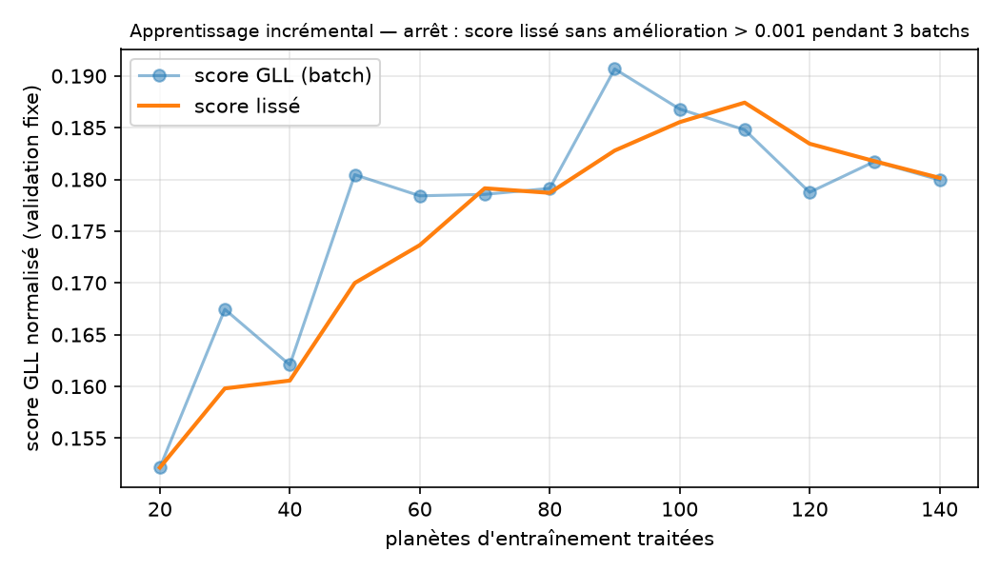

# NeurIPS — Ariel Data Challenge 2025 · pipeline MLOps incrémental

Extraction du spectre de transmission d'exoplanètes (mission ESA Ariel, données simulées) et
prédiction **μ ± σ** de Rp/Rs sur 283 longueurs d'onde, avec une chaîne MLOps complète.
Métrique : Gaussian Log-Likelihood normalisée (0 = baseline naïve, 1 = oracle).

## Le problème d'ingénierie

Le dataset pèse **~264 Go** (1100 planètes × ~240 Mo). Il ne tient pas sur un poste de travail, et
à ~1,5 Mo/s le télécharger entièrement prendrait environ **40 h**. Plutôt que de subir cette
contrainte, le projet en fait un principe : un **apprentissage incrémental** qui s'arrête
quand les données supplémentaires n'améliorent plus le modèle.

```
tirage mélangé (seed) ─► validation FIXE (traitée une fois)
        │
        ▼  pour chaque batch de N planètes
 télécharger (API Kaggle) ─► traiter le signal (Numba) ─► supprimer le brut
        ─► réentraîner sur tout l'accumulé ─► score GLL sur la validation fixe
        ─► arrêt si le score lissé stagne `patience` batchs
```

Choix de conception : validation fixe (scores comparables), ordre mélangé, un fichier par batch
(rejouer un batch ne duplique rien), état JSON (reprise après interruption), arrêt sur score lissé.
Code : `src/pipelines/incremental.py` ; 10 tests dans `tests/unit/test_incremental.py`.

## Résultat



- Arrêt automatique après **14 batchs (140 planètes d'entraînement, ~13 % des 1100)** : le score lissé n'a pas gagné plus de 0,001 pendant 3 batchs.
- Score GLL sur validation fixe (20 planètes) : **0,15 avec 20 planètes → 0,18–0,19 dès 90 planètes** ; meilleur score lissé **0,187** (110 planètes).
- Coût : ~4 min 15 par planète (2 min 45 de téléchargement + 1 min 30 de traitement), soit ~10 h pour 140 planètes contre ~78 h pour les 1100.
- Lecture : le plateau montre que la limite n'est plus la quantité de données mais le modèle (Ridge, σ constant) et la qualité des spectres extraits (bruit, rampe dans le bleu). La validation est petite : les variations de ±0,01 entre batchs sont dans le bruit statistique.

## Limites connues (honnêteté sur l'état du projet)

- Le spectre extrait par la méthode médiane in/out est **bruité** (bruit 5 à 10× supérieur à la
  variation spectrale réelle sur les 3 planètes testées) et présente une **rampe systématique
  dans le bleu** (~10 premiers canaux AIRS). Le niveau moyen est correct pour 2 planètes sur 3.
- Le modèle de base est un Ridge avec σ constant par longueur d'onde ; le MLP hétéroscédastique
  (`src/models/model.py`) n'est pas encore branché sur la boucle.
- L'orchestration Airflow (`airflow/dags/ariel_incremental.py`) et le `docker-compose.yml` n'ont pas encore été validés de bout en bout.

## Traitement du signal

CDS (end − start), correction ADC (`/= gain`, `+= offset`), dark, flat, pixels morts, hot pixels
(σ-clipping MAD), non-linéarité (polynôme de Horner), binning temporel, puis Rp/Rs par médianes
in/out transit. Numba (`@njit`, `prange`) + joblib. Code dans `src/signal_processing/`.

## Stack

| Outil | Rôle |
|---|---|
| uv, pytest | environnement, tests (~100 tests unitaires) |
| Kaggle API | téléchargement par planète |
| MLflow | suivi du score GLL en fonction du nombre de planètes |
| Airflow | un run = un batch, auto-déclenchement jusqu'à l'arrêt |
| Docker / compose | profils `mlflow`, `incremental`, `airflow`, `test` |
| DVC / DagsHub | versionnement des 7 fichiers racine et du `train.csv` enrichi |
| GitHub Actions | CI (`.github/workflows/ci.yml`) |

## Démarrage

```bash
uv sync && uv add -r requirements.txt
uv run python -m pytest tests/unit -q -m "not slow"
uv run python -m src.pipelines.incremental --batch-size 20 --val-size 40 --mlflow
uv run python scripts/plot_score_curve.py
```
Identifiants Kaggle : `~/.kaggle/kaggle.json` ou variables `KAGGLE_USERNAME` / `KAGGLE_KEY` (`.env`, non versionné).

## Structure

```
src/data/ (collecte Kaggle) · src/signal_processing/ · src/ml/ (features, métrique)
src/models/ (MLP, baselines) · src/pipelines/incremental.py · airflow/dags/ · docker/ · scripts/ · tests/
```
